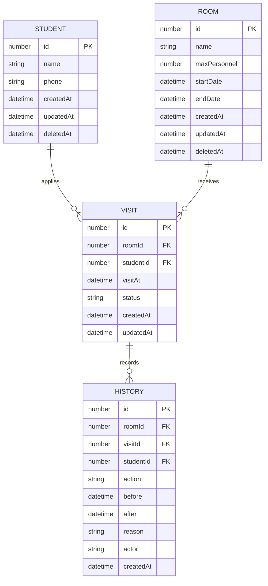

# 데이터 모델

JSON 루트는 `students`, `rooms`, `visits`, `history` 배열입니다. 필수 학생·자습실 엔티티를 유지하고 자습실 이름, 방문 신청, 이력을 추가했습니다. ID는 컬렉션별 기존 최댓값 + 1이며 Soft Delete로 이전 ID를 재사용하지 않습니다.

## 관계와 제약

- `deletedAt`은 미삭제이면 `null`, 삭제되면 UTC ISO 일시입니다.
- `Visit.status`: `ACTIVE` / `CANCELLED`.
- `(roomId, studentId)`당 Visit는 한 건입니다. 취소 후 같은 객체를 활성화하므로 인원 집계와 조회가 단순합니다.
- 활성 Visit 수 ≤ Room.maxPersonnel.
- startDate ≤ visitAt ≤ endDate, startDate < endDate.
- 부모를 물리 삭제하지 않아 과거 이력의 학생/자습실 참조를 유지합니다.
- 이력은 추가만 하고 수정·삭제하는 API는 없습니다. 단, 파일 자체는 운영자가 편집할 수 있으므로 위변조 방지 감사 저장소는 아닙니다.

## 상태 전이

| 동작        | 이전 상태 | 다음 상태 | 이력                       |
| ----------- | --------- | --------- | -------------------------- |
| 최초 신청   | 없음      | ACTIVE    | APPLIED                    |
| 시간 변경   | ACTIVE    | ACTIVE    | CHANGED                    |
| 취소        | ACTIVE    | CANCELLED | CANCELLED                  |
| 재신청      | CANCELLED | ACTIVE    | REAPPLIED                  |
| 자습실 삭제 | ACTIVE    | CANCELLED | CANCELLED + 자동 취소 사유 |

`before/after`는 방문 예정 시각입니다. 최초 신청의 before와 취소의 after는 null입니다. `createdAt`은 이력이 발생한 서버 시각입니다. 같은 밀리초의 이벤트는 증가하는 ID 순서로 구분합니다. 학생명은 조회 시 연결하므로 학생명을 변경하면 과거 이력에도 현재 이름이 표시됩니다. 이름 스냅샷이 필요하면 이벤트에 별도 필드를 추가할 수 있습니다.

## RDBMS 전환안

- students/rooms/visits/history 테이블과 외래 키.
- UNIQUE(visits.room_id, visits.student_id).
- INDEX(visits.room_id, visits.status), INDEX(visits.student_id), INDEX(history.room_id, history.id).
- CHECK(max_personnel > 0), CHECK(start_date < end_date), 상태 enum/check.
- 정원 검사는 여러 행에 걸친 규칙이므로 단순 CHECK가 아니라 room 행 잠금을 잡은 트랜잭션으로 수행합니다.
- 운영 기간 수정·삭제·신청이 같은 자습실 잠금을 공유해야 충돌을 일관되게 처리할 수 있습니다.
